<!-- ═══════════════════════ HERO ═══════════════════════ -->

<!-- ═══════════════════════ TYPING INTRO ═══════════════════════ -->

   
  

  
  
  
  
  

 

<!-- ═══════════════════════ BY THE NUMBERS ═══════════════════════ -->

 

 

<!-- ═══════════════════════ SHORT VERSION ═══════════════════════ -->

  
  &nbsp;&nbsp;
  

 

<!-- ═══════════════════════ TROPHY CASE ═══════════════════════ -->

 

<table>
<tr>
<td width="50%" valign="top">

### 2nd place, nationally
**Kaya AI IIT India Hackathon 2026**

`1,460 participants` → `20 shortlisted` → `10 finalists` → **`2nd`**

A team of two against teams of four. Presented **Foreman** live on the deployed app, not a recording, to judges from **Google, OpenAI, Meta** and the Kaya CEO, and took every question.

</td>
<td width="50%" valign="top">

### Hired by the company that ran it
**Engineering Intern · Kaya AI** (US startup)

Remote, from September 2026, while in 2nd year. I ship into a production codebase and stand up daily with the US team.

</td>
</tr>
<tr>
<td width="50%" valign="top">

### Merged upstream
**4 PRs in, 4 more in review**

3 merged into **[Docling](https://github.com/docling-project/docling)** (69k★, IBM Research) and 1 into **[PyBaMM](https://github.com/pybamm-team/PyBaMM)**, a GSoC org. Every one a real parser bug or feature, none of them typo fixes.

</td>
<td width="50%" valign="top">

### Backend lead, team of 6
**[PulseBoard](https://github.com/Aeshvarya/PulseBoard)** · Winter of Code '26

Owned the backend: IMAP email pipeline → Gemini event extraction, TOTP 2FA, JWT + Google OAuth, a cron real-time engine. 9 PRs merged.

</td>
</tr>
</table>

 

<!-- ═══════════════════════ JOURNEY ═══════════════════════ -->

 

 

<!-- ═══════════════════════ OPEN SOURCE ═══════════════════════ -->

 

| Repo | PR | What it does | Status |
| :--- | :- | :----------- | :----: |
| **docling-project/docling** · 69k★ | [#4721](https://github.com/docling-project/docling/pull/4721) | Fixes 3 AsciiDoc nested-list parsing bugs |  |
| **docling-project/docling** · 69k★ | [#4822](https://github.com/docling-project/docling/pull/4822) | Nests lists that use different bullet markers |  |
| **docling-project/docling** · 69k★ | [#4824](https://github.com/docling-project/docling/pull/4824) | Adds bold, italic and monospace parsing to AsciiDoc |  |
| **pybamm-team/PyBaMM** · GSoC org | [#5923](https://github.com/pybamm-team/PyBaMM/pull/5923) | Rejects non-positive step times, accepts NumPy temperatures |  |
| **mesa/mesa** · 3.9k★ | [#3959](https://github.com/mesa/mesa/pull/3959) | Even-r layout for HexGrid cell positions |  |
| **pybamm-team/PyBaMM** | [#5971](https://github.com/pybamm-team/PyBaMM/pull/5971) | Clearer `step.string` errors, tolerates extra whitespace |  |
| **prowler-cloud/prowler** · 15k★ | [#12586](https://github.com/prowler-cloud/prowler/pull/12586) · [#12587](https://github.com/prowler-cloud/prowler/pull/12587) | Two new SageMaker security checks |  |

 

<!-- ═══════════════════════ BUILDING ═══════════════════════ -->

 

| Project | What it is | Stack |
| :------ | :--------- | :---- |
| **Mender** | My startup, co-founded. Keeps AI-built apps working and safe: health and security checks, surgical fixes, regression locks. Building in private. | Python |
| **Foreman** | Schedule-consequence engine for construction supply chains. Given a late material, it finds which activities slip, whether handover survives, and the cheapest priced fix, with the probability from 3,000 Monte-Carlo passes rather than an LLM guess. **2nd of 1,460.** | FastAPI · Neo4j · LangGraph · React 19 |
| **[PulseBoard](https://github.com/Aeshvarya/PulseBoard)** | Campus event aggregator. Reads college email, AI-extracts the events, notifies students. | Express · MongoDB · Gemini · Expo |
| **[TourThat](https://github.com/Aeshvarya/tourthat)** | Phone video of a house → shareable 3D walkthrough in the browser, with Gaussian splatting. | Three.js · COLMAP · Vite |
| **[MindLedger](https://mind-ledger-beige.vercel.app)** | Live. An AI pressure valve, not a to-do list: Gemini breaks tasks down, the UI reacts to dread. | Next.js · Supabase · Gemini |

> **Right now:** three hackathon builds in flight: Nebius × NVIDIA, Airwallex and GitLab.

 

<!-- ═══════════════════════ ARSENAL ═══════════════════════ -->

 

 

  

 

<!-- ═══════════════════════ PROOF OF WORK ═══════════════════════ -->

  
  

  

 

  

 

  <picture>
    <source media="(prefers-color-scheme: dark)" srcset="https://raw.githubusercontent.com/Aeshvarya/Aeshvarya/output/github-snake-dark.svg" />
    <source media="(prefers-color-scheme: light)" srcset="https://raw.githubusercontent.com/Aeshvarya/Aeshvarya/output/github-snake.svg" />
    
  </picture>

 

<!-- ═══════════════════════ FOOTER ═══════════════════════ -->

 

<em>"Discipline is choosing between what you want now and what you want most."</em>

  

