<picture>
  <source media="(prefers-color-scheme: dark)" srcset="assets/hero-dark.svg">
  
</picture>

  

Second-year at IIT Jodhpur, engineering intern at Kaya AI, co-founder of Mender.
I like problems where the answer has to be right, not just plausible.

 

<picture>
  <source media="(prefers-color-scheme: dark)" srcset="assets/record-dark.svg">
  
</picture>

  

<picture>
  <source media="(prefers-color-scheme: dark)" srcset="assets/signal-dark.svg">
  
</picture>

  

<picture>
  <source media="(prefers-color-scheme: dark)" srcset="assets/oss-dark.svg">
  
</picture>

**Docling** &nbsp;IBM Research · 70k ★ 
[#4721](https://github.com/docling-project/docling/pull/4721) nested AsciiDoc lists &nbsp;·&nbsp; [#4822](https://github.com/docling-project/docling/pull/4822) mixed bullet markers &nbsp;·&nbsp; [#4824](https://github.com/docling-project/docling/pull/4824) bold, italic, monospace

**PyBaMM** &nbsp;battery modelling · GSoC org 
[#5923](https://github.com/pybamm-team/PyBaMM/pull/5923) step-time validation &nbsp;·&nbsp; [#5971](https://github.com/pybamm-team/PyBaMM/pull/5971) clearer step errors &nbsp;·&nbsp; [#6033](https://github.com/pybamm-team/PyBaMM/pull/6033) ignored voltage terminations

**Mesa** &nbsp;agent-based modelling 
[#3959](https://github.com/mesa/mesa/pull/3959) even-r layout for hex grids

**Prowler** &nbsp;in review 
[#12586](https://github.com/prowler-cloud/prowler/pull/12586) · [#12587](https://github.com/prowler-cloud/prowler/pull/12587) two SageMaker security checks

 

<picture>
  <source media="(prefers-color-scheme: dark)" srcset="assets/work-dark.svg">
  
</picture>

**Foreman** &nbsp;FastAPI · Neo4j · LangGraph · React 
A material is late. Which activities slip, does handover survive, and what is the cheapest fix? Answered with 3,000 Monte Carlo runs, not an LLM guess. Took 2nd of 1,460.

**[Loadbearing](https://github.com/varunikarai/loadbearing)** &nbsp;Nebius · NVIDIA Nemotron 
Finds which inputs a pipeline actually depends on by forking it over mutated inputs. Built with [@varunikarai](https://github.com/varunikarai). [Live ↗](https://loadbearing-demo.vercel.app)

**[Countersign](https://github.com/Aeshvarya/countersign)** &nbsp;agentic payments 
A merchant checkout that countersigns a verified agent and the shopper's approved terms before any money moves.

**[PulseBoard](https://github.com/Aeshvarya/PulseBoard)** &nbsp;Express · MongoDB · Gemini · Expo 
Reads college email, extracts the events, notifies students. I led the backend for a team of six.

**[TourThat](https://github.com/Aeshvarya/tourthat)** &nbsp;Three.js · COLMAP · Gaussian splatting 
A phone video of a house becomes a 3D walkthrough in the browser.

 

<picture>
  <source media="(prefers-color-scheme: dark)" srcset="assets/links-dark.svg">
  
</picture>

[Portfolio](https://portfolio-ruddy-eight-43.vercel.app) &nbsp;↗ &emsp; [LinkedIn](https://www.linkedin.com/in/aeshvarya-awasthi/) &nbsp;↗ &emsp; [YouTube](https://www.youtube.com/@zackvlogs24) &nbsp;↗ &emsp; [Email](mailto:aeshvarya310305@gmail.com) &nbsp;↗

 

<picture>
  <source media="(prefers-color-scheme: dark)" srcset="assets/footer-dark.svg">
  
</picture>
